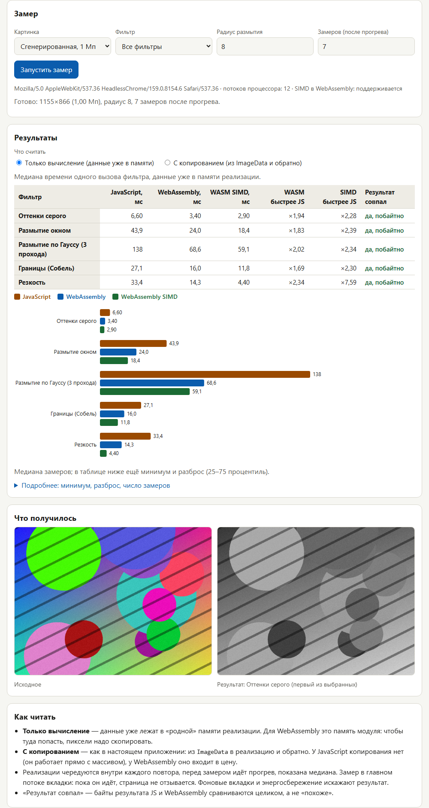

# wasm-vs-js-filters

[](https://github.com/Oleg4311/wasm-vs-js-filters/actions/workflows/ci.yml)
[Замер онлайн](https://oleg4311.github.io/wasm-vs-js-filters/) · [Релизы](https://github.com/Oleg4311/wasm-vs-js-filters/releases)

**Что на самом деле быстрее: JavaScript или WebAssembly?** Пять фильтров изображения написаны дважды, на JavaScript и на Rust (WebAssembly в двух сборках: обычной и с SIMD), одними и теми же алгоритмами и целочисленной арифметикой. Результаты совпадают **побайтно**, и это проверяется тестами и самой страницей. Замер идёт у вас в браузере, на вашем железе, с прогревом, медианой и отдельной цифрой «с копированием» (потому что в настоящем приложении данные приходится переносить в память модуля).



*English: the same five image filters in JavaScript and in Rust→WebAssembly (scalar and SIMD), bit-identical output verified by tests, benchmarked in your own browser with and without the JS↔WASM copy cost. See the [English section](#english).*

## Результат (Chromium 159, 12 потоков, Windows, картинка 2 Мп, радиус 8, медиана 11 замеров)

Только вычисление, мс ([полная таблица и вариант с копированием](docs/bench-chromium-local.md)):

| Фильтр | JavaScript | WebAssembly | WASM SIMD | WASM быстрее | SIMD быстрее |
|---|---:|---:|---:|---:|---:|
| Оттенки серого | 14,4 | 7,2 | 5,5 | ×2,0 | ×2,6 |
| Размытие окном | 97,6 | 45,6 | 39,8 | ×2,1 | ×2,5 |
| Размытие по Гауссу (3 прохода) | 267 | 130 | 115 | ×2,0 | ×2,3 |
| Границы (Собель) | 43,3 | 27,0 | 19,9 | ×1,6 | ×2,2 |
| Резкость (свёртка 3×3) | 65,7 | 27,9 | 9,7 | ×2,4 | ×6,8 |

Что из этого следует (и чего не следует):

- **WebAssembly быстрее JS примерно в 1,6–2,4 раза** на этих задачах, **SIMD добавляет до ×6,8** там, где цикл хорошо векторизуется (резкость), и почти ничего там, где работа упирается в обращения к таблице (размытие).
- **Копирование стоит дорого на лёгких фильтрах.** У оттенков серого с копированием выигрыш WebAssembly падает с ×2,0 до ×1,5, потому что перенос 8 МБ туда и обратно сравним с самой работой. На тяжёлых фильтрах копирование незаметно. Практический вывод: переносить в WebAssembly имеет смысл цепочки операций (копируем один раз), а не одиночный лёгкий фильтр.
- **Это не «WebAssembly всегда в разы быстрее».** Первая версия замера давала разницу до ×4 (оттенки серого, резкость), и часть причин была не в языке (см. ниже). Разница в 2 раза честна для оптимизированного JS на этих задачах, но не универсальна: другая задача, другой браузер или многопоточность (Web Workers, WebGL, WebGPU) меняют картину. Откройте [страницу](https://oleg4311.github.io/wasm-vs-js-filters/) и измерьте у себя.

### Чему научил сам замер

1. **Тип массива.** Сначала JS получал `Uint8Array` (внутренние буферы) и `Uint8ClampedArray` (из `ImageData`) в одной и той же функции: V8 видит два типа, и функция работает вдвое медленнее. Теперь JS всегда работает с `Uint8Array` поверх того же `ArrayBuffer`, что и `ImageData` (без копирования).
2. **Деление.** В размытии на каждый отсчёт приходится делить на размер окна. Деление в JS медленное; таблица готовых ответов ускорила размытие примерно в ×1,3–1,5. Затем то же сделал и Rust: сначала я оставил в нём деление в `f32` (оно векторизуется), и JS с таблицей выигрывал у WebAssembly. Проверил обе стратегии для обеих сборок: таблица оказалась быстрее и со SIMD, и без. Теперь обе стороны используют лучшее, что я нашёл, а результат остаётся побайтно одинаковым.
3. **Прогрев и порядок.** Реализации чередуются внутри каждого повтора и сдвигаются по кругу, перед замером идёт прогрев, иначе оптимизирующий компилятор «догоняет» посреди измерения.

## Как устроено

```
Rust (src/lib.rs) ──cargo──▶ filters.wasm        (обычный)           ─┐
                  └─ +simd128 ▶ filters-simd.wasm (тот же код + SIMD)  ├─▶ js/wasm.js (alloc/dealloc + f_*, без wasm-bindgen)
JavaScript (js/filters.js) — те же алгоритмы шаг в шаг               ─┘          │
                                                                                 ▼
                                      js/bench.js: прогрев, чередование, медиана, побайтная сверка
```

Фильтры: оттенки серого (целочисленная яркость), размытие окном (скользящая сумма, два прохода), размытие по Гауссу (три размытия окном), границы по Собелю, резкость (свёртка 3×3). Края изображения: повторение крайних пикселей. Прозрачность сохраняется. Всё в целых числах, поэтому совпадение бывает точным, а не «в пределах погрешности».

WebAssembly подключается без `wasm-bindgen`: три-четыре C-функции (`alloc`, `dealloc`, `f_*`) и линейная память ([js/wasm.js](js/wasm.js)). Сборка со SIMD — тот же исходник с `-C target-feature=+simd128`; страница проверяет поддержку и, если её нет, показывает «недоступно».

## Что проверено

- **Побайтное совпадение трёх реализаций** ([test/equivalence.test.js](test/equivalence.test.js)): 160 случайных изображений из случайных байтов (в том числе случайная прозрачность) размером от 1×1 до 40×40 и радиусами 0–100; вырожденные размеры 1×N, N×1, 2×2; картинка с градиентами и резкими границами; однотонные чёрная и белая при радиусе 255 (максимальные суммы).
- **Мутации**: изменение коэффициента яркости, сдвиг окна размытия, зажим Собеля, ядро резкости, округление в таблице деления — тесты падают (проверено по одной).
- **Rust** ([src/lib.rs](src/lib.rs)): 8 тестов, в том числе таблица деления сверена с целочисленным делением на всех радиусах и всех возможных суммах, вырожденные размеры без паники.
- **Память**: тысяча заданий подряд не увеличивает память модуля.
- **Страница**: 14 браузерных тестов (десктоп и мобильный): все пять фильтров совпали, режим «с копированием», загрузка своего файла, блокировка кнопки на время замера, доступность (axe) в светлой и тёмной теме, нет горизонтальной прокрутки.
- CI: `cargo fmt`, `clippy -D warnings`, тесты Rust, сборка на минимальной версии Rust 1.82, тесты Node на Node 22 и 24, e2e, замер в CI как артефакт.

## Честные ограничения

- Замер в **одном потоке** главного потока вкладки; WebGL, WebGPU и Web Workers не участвуют. Эти пути часто быстрее обоих.
- Цифры выше получены в **Chromium (headless)** на одном компьютере. Firefox и Safari оптимизируют иначе, поэтому страница и существует: измерьте у себя.
- Сравнивается **моя** реализация на JS с **моей** реализацией на Rust. Есть куда оптимизировать обе (например, разворачивание циклов в JS, блочный проход по кэшу в обеих). Я остановился там, где дальнейшие приёмы переставали быть «внимательным разработчиком» и становились соревнованием в микрооптимизации.
- Пять фильтров над целыми числами в формате RGBA8: это не обобщение на любые задачи WebAssembly (вычисления с плавающей запятой, строки, сжатие ведут себя иначе).
- На маленьких изображениях разрешение таймера (0,1 мс в Chromium) искажает отдельные значения: используйте больше замеров или картинку побольше.

## Разработка

```bash
rustup target add wasm32-unknown-unknown
cargo test                          # тесты Rust (родная платформа)
npm ci
npm test                            # сборка обоих модулей + сверка JS/WASM/SIMD
npm run bench                       # замер в Node (V8)
npm run site && npm run serve       # страница на http://127.0.0.1:4184/
npx playwright install chromium && npm run e2e
node scripts/bench-browser.mjs 2 11 8 --out docs/bench.md   # замер в Chromium
```

Релизы (`v*`) собираются в CI после тестов, содержат модули, JS и контрольные суммы с подтверждением происхождения: `gh attestation verify wasm-vs-js-filters-v0.1.0.tar.gz --repo Oleg4311/wasm-vs-js-filters`.

Лицензия: MIT. Сделано с помощью Claude.

---

## English

**wasm-vs-js-filters** implements five image filters (grayscale, box blur, 3-pass Gaussian approximation, Sobel, 3×3 sharpen) twice — in JavaScript and in Rust compiled to WebAssembly (scalar and `+simd128`) — with integer arithmetic so the outputs are **bit-identical** (tested on random bytes incl. random alpha, degenerate sizes, extreme radii; five mutations are caught). The page benchmarks them in your own browser (warm-up, interleaved runs, median) in two modes: compute only, and with the JS↔WASM copy cost.

On a 2 MP image in Chromium 159: WebAssembly is ≈1.6–2.4× faster than JS, SIMD up to 6.8× (3×3 sharpen), but the copy cost cuts the win on light filters (grayscale ×2.0 → ×1.5). Lessons from benchmarking itself: mixing `Uint8Array` and `Uint8ClampedArray` made V8 slower, and replacing per-sample division with a lookup table sped up the blur in both languages — the first naive comparison exaggerated the gap (up to 4× on grayscale and sharpen).

Honest limits: single-threaded, no WebGL/WebGPU/Workers, Chromium numbers from one machine, my JS vs my Rust, five integer filters only. MIT licensed. Built with Claude.
